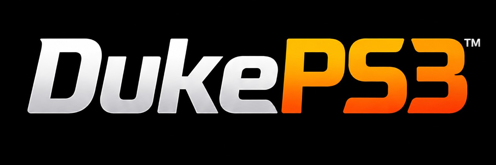

# DukePS3

**Emulación de PlayStation 3 en Android: basada en RPCS3 y mejorada con pruebas en dispositivos reales.**

[English](README.md) · [Versiones publicadas](https://github.com/thecrixux/PS3Native/releases) · [Compilación Android](android/README.md)

DukePS3 es un fork para Android de [RPCS3](https://github.com/RPCS3/rpcs3), desarrollado a partir de PS3Native y del port original RPCS3-Android. Nos centramos en **compatibilidad, estabilidad, regularidad de los fotogramas y rendimiento práctico tanto en Snapdragon/Adreno como en MediaTek/Mali**.

El núcleo y la interfaz Android comparten el mismo repositorio. Integramos cambios de upstream junto con correcciones específicas para Android y una interfaz Compose Material 3 con identidad propia.

## Qué ofrece DukePS3

| Área | Funciones |
| --- | --- |
| **Emulación** | Renderizado Vulkan, recompiladores PPU/SPU mediante LLVM y cachés de compilación reutilizables. |
| **Generación de frames** | LSFG mediante shaders propietarios de Lossless Scaling y DIS gratuito integrado. |
| **Juegos y ajustes** | Biblioteca con búsqueda, consulta de compatibilidad, ajustes globales/por juego, actualizaciones de juegos y gestión de parches. |
| **Gráficos y drivers** | Modo de vídeo de PS3 y escala de renderizado separados; importación de drivers y repositorios cuando el dispositivo lo permite. |
| **Durante la partida** | Controles táctiles editables y menú para pausar, continuar, configurar y detener la emulación. |
| **Mediciones** | HUD personalizable, gráfica de tiempos de fotograma, FPS del juego y de salida diferenciados, y capturas de rendimiento exportables. |
| **Audio y diagnóstico** | Selección Automático/AAudio/OpenSL ES, logs compartibles, información del sistema y exportación de WAV + log. |
| **Diseño** | Tema oscuro Duke Gold, bienvenida ilustrada, logo en el menú e iconos adaptativos y monocromos. |

## Mejoras recientes

- **Preparación PPU inicial más rápida:** evitamos recorridos repetidos de carpetas y comprobaciones duplicadas de ejecutables. Los hilos de compilación LLVM respetan el límite de memoria existente y el log separa los tiempos de compilación. En las pruebas se ha observado un inicio más rápido; el ahorro depende del juego y de su caché.
- **Cachés reutilizables:** las siguientes cargas aprovechan los módulos que ya se han compilado.
- **Correcciones gráficas:** solucionados fallos de renderizado tras integrar cambios de upstream, y separados el modo de vídeo del juego y la escala interna para configurar mejor la resolución.
- **Más nitidez en Mali:** G-Force probado en 720p con escala del 150 %, manteniendo unos 60 FPS en la escena de referencia.
- **DIS más fluido:** optimizaciones adaptadas de OpenFlow, mejoras en su presentación Vulkan y en la distribución temporal de los fotogramas. Las pruebas de G-Force en Adreno 710 mostraron una mejor sensación de fluidez tras estos cambios.
- **Mediciones más útiles:** muestreo de FPS/tiempos de fotograma mejorado, indicador de salida `OUT` separado y capturas que no cuentan los fotogramas generados como rendimiento del juego.
- **Fondo de carga recuperado:** la imagen del juego aparece durante la preparación de módulos, en lugar del fondo negro.
- **Audio mejorado en MediaTek:** cambios en la producción del audio redujeron notablemente los artefactos intermitentes en el Dimensity 8300 de prueba. Queda una pequeña incidencia residual pendiente.
- **Diagnóstico más sencillo:** capturas de rendimiento con `summary.json` y `frames.csv`, y exportación del último WAV finalizado junto con el log actual.

## Pruebas en dispositivos reales

G-Force es nuestro juego de referencia: se prueba repetidamente en la misma escena.

| Dispositivo | Resultado observado |
| --- | --- |
| **Snapdragon / Adreno 710** | Aproximadamente **35–42 FPS del juego a resolución nativa** en las pruebas de referencia. Mejor sensación de fluidez con DIS optimizado; audio reportado limpio. |
| **POCO X6 Pro / Dimensity 8300 / Mali** | Aproximadamente **60 FPS del juego en la escena de referencia**, también probando **720p + escala del 150 %**. El fallo de corrupción al aumentar la resolución quedó resuelto en esa prueba. |

Son resultados de un juego, versiones y ajustes concretos; no garantizan el mismo funcionamiento en todos los títulos o dispositivos. Los FPS del juego y los FPS de salida con generación son mediciones diferentes. Influyen el driver, la memoria disponible y la temperatura. La integración LSFG está disponible, pero no formó parte de estas pruebas del mantenedor porque no se disponía de sus shaders propietarios.

## Generación de frames: LSFG y DIS

| Motor | Qué necesitas | Qué incluye el emulador |
| --- | --- | --- |
| **DIS — Dense Inverse Search** | GPU/driver compatibles. **Sin compra ni DLL.** | Motor gratuito de flujo óptico y shaders integrados en la app. |
| **LSFG — Lossless Scaling** | Tu propia copia con licencia de Lossless Scaling y una `Lossless.dll` compatible. | Integración Vulkan e importación de shaders. **La DLL y los shaders propietarios no se distribuyen.** |

Entra en **Frame Gen** desde la biblioteca o el menú durante la partida, selecciona motor y preset y activa la generación. DIS ofrece **Light, Fast, Balanced y Quality**. Los controles permiten multiplicadores **2×/3×/4×** u objetivos de **60/90/120 FPS**.

LSFG lee los shaders de la DLL, los traduce cuando corresponde y los guarda en la caché local. La DLL se trata como datos y no se ejecuta.

La generación puede mejorar la fluidez visual, pero consume GPU y añade latencia. Una cifra de salida más alta no acelera la simulación del juego ni garantiza una respuesta mejor. `OUT` mide el ritmo de presentación, sumando fotogramas reales e interpolados; no cuenta solamente los generados.

El DIS integrado procede del trabajo de **qwertypower (DEVAR Entertainment LLC)** en WinNative, ahora denominado **OpenFlow**, y tiene sus raíces en DISOpticalFlow de OpenCV y OF_DIS de Till Kroeger. Adaptamos sus optimizaciones al renderizador Vulkan de RPCS3; no se incluye la ruta de estimación de movimiento por hardware. Los [créditos completos y la procedencia del código](README.md#credits) se conservan en el README principal.

## Primeros pasos

1. Instala el APK y completa el acceso al almacenamiento y la instalación del firmware. **No se incluyen juegos ni firmware de PS3.**
2. Añade una carpeta de juego, arranca una imagen de disco o instala un paquete desde la biblioteca.
3. Empieza con los ajustes gráficos predeterminados. Para aumentar el detalle, conserva el **modo de vídeo PS3 en 720p** y cambia **Render scale**. Si la base es 1280×720, el 150 % corresponde a 1920×1080; la escala efectiva depende del juego y de sus superficies.
4. Para probar el motor gratuito, elige DIS y compara la misma escena con generación apagada y encendida.

**Requisitos:** Android 12 o posterior, dispositivo ARM64 con las funciones de CPU necesarias y driver Vulkan compatible. La comprobación actual incluye LSE atomics, FP16, RDM y dot product. La RAM disponible limita cuántos hilos de compilación pueden funcionar simultáneamente.

**Paquete:** `com.crixux.dukeps3` · **Versión de la app:** `1.0.0`.

El paquete nuevo se instala como otra app: no migra automáticamente partidas, firmware, cachés ni preferencias privadas desde PS3Native. Conserva la instalación anterior hasta copiar y comprobar los datos que necesites.

## Mediciones y reportes

El HUD muestra FPS, tiempos de fotograma, RAM y sensores disponibles. Si un sensor no está accesible, puede aparecer `N/A`.

Para comparar, mantén juego, escena, ajustes y condiciones térmicas similares. Las capturas registran **intervalos de flip RSX**, excluyen carga/pausas y fotogramas generados, y exportan resumen JSON y tiempos CSV. Al medir el arranque, distingue entre reconstruir la caché PPU y abrir otra vez con la caché existente.

Para investigar audio, activa **Dump to file**, reproduce el problema, detén normalmente el juego y usa **Debug → Export audio capture**. Se exportan el WAV finalizado y el log actual. Deja el volcado desactivado durante el uso normal si no necesitas una captura.

Los reportes ayudan más cuando incluyen juego/ID, dispositivo, driver, ajustes, pasos para reproducir el fallo y un log o captura de rendimiento.

## Pendiente

- Ampliar las pruebas de compatibilidad más allá de G-Force.
- Resolver los pequeños artefactos de audio residuales en MediaTek.
- Seguir comprobando la disponibilidad de drivers y motores de generación en distintas GPU.
- RPCN aún no tiene interfaz de inicio de sesión en Android; el netplay completo no está verificado.

## Compilar

Las instrucciones están en el [README Android](android/README.md). Se utilizan **JDK 17, SDK Android 35, NDK 29.0.14206865 y CMake 3.31.6**, con LLVM y FFmpeg preparados para `arm64-v8a`.

La variante normal es `standard`. Los nombres de tareas antiguos `antutu`, `ludashi` y `pubg` siguen existiendo por compatibilidad con scripts, pero **todas las variantes actuales usan `com.crixux.dukeps3`**.

## Créditos y licencia

DukePS3 se apoya en el trabajo de **RPCS3, RPCS3-Android, PS3Native y los desarrolladores de WinNative/OpenFlow**, además de las contribuciones descritas en los [créditos completos del README principal](README.md#credits).

La mayoría de archivos están bajo **GPL-2.0-only**; consulta [LICENSE](LICENSE). Otros componentes tienen sus propias licencias, incluyendo archivos de generación de frames bajo **GPL-3.0-or-later**. Revisa sus cabeceras y licencias correspondientes. DukePS3 no está afiliado ni respaldado por Sony Interactive Entertainment.
